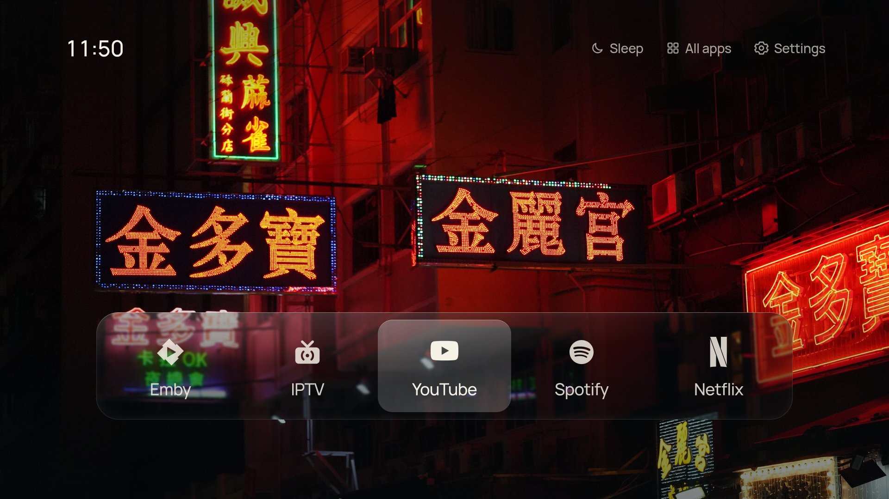

# xiaomi-tv-stick-launcher

A quiet home screen (launcher) for the **Xiaomi TV Stick 4K / Mi TV Stick** and other Android TV
sticks: your apps on a glass dock over a photograph, plus the time. It replaces the stock Android TV
home screen, with no ads and no recommendation rows. Photos are added from a
phone on the same network, and the stick sleeps on a timer you set.



*Taken on a Xiaomi TV Stick 4K (`adb exec-out screencap`, 1920×1080, 2026-11-03), with our own dock.
Wallpaper: "LED and neon signs on Portland Street at night" by Benlisquare,
[Wikimedia Commons](https://commons.wikimedia.org/wiki/File:LED_and_neon_signs_on_Portland_Street_at_night.jpg),
[CC BY-SA 4.0](https://creativecommons.org/licenses/by-sa/4.0/). This screenshot is shared under the same licence.
The app marks belong to their owners.*

It is the [CleanFrame](https://github.com/nthnclrk/CleanFrame) web home screen (built for the
Samsung The Frame) ported to Android TV as a full-screen WebView app. On the stick it is still
called **CleanFrame** (package `home.cleanframe.tv`).

## Sticks it runs on

| Stick | Android | WebView | Notes |
|---|---|---|---|
| Xiaomi TV Stick 4K (`MiTV-AYFR0`, codename `soul`) | Android TV 11 | Chrome 156 | The main target. Stock launcher (`com.google.android.tvlauncher`) disabled; CleanFrame is the only launcher. |
| Hugsun HS89 T19-1 (a generic Chinese stick) | Android 14 | 113 | Works as-is. The app handles this stick's exact alarms and its Emby and YouTube package names. |

Other Android TV devices should work as long as they run API 26 or later, and it will probably work on
other generic Chinese sticks like the Hugsun. The APK has no native libraries; minSdk is 26 and targetSdk
is 34. They are untested, and some apps may need their package names added, as the Hugsun's did.

**If an app does not get the right icon automatically:** hold OK on it for about a second, choose **Change icon**, and
pick one of the premade icons. **App's own icon** goes back to the app's original.

**On your own stick:** make your own signing key (see *Build and install*; `build.sh` reads it from
`~/.config/cleanframe-tv/`), put its certificate's SHA-256 in `tools/signer-cert.sha256` and commit that:
`build.sh` and `install.sh` only accept APKs signed by the key pinned there.

- **Upstream UI:** [nthnclrk/CleanFrame](https://github.com/nthnclrk/CleanFrame) `app/` at
  `58ac92a7b8f80047ca26e5b7097f5e1616762db0` (2026-10-27), MIT. See `LICENSE-CleanFrame` and
  `THIRD_PARTY_NOTICES.md`; fonts, photographs and logos keep their own terms. Upstream was built
  for one device (Samsung The Frame, Tizen).
- **Licence:** this repository's own code is MIT (`LICENSE`), so anyone may use it. CleanFrame
  and the bundled fonts, photographs and marks keep their own terms (`THIRD_PARTY_NOTICES.md`).
- **Rules:** read `docs/RULES.md` before changing anything.
- **History:** this repository starts from one clean commit. Commit hashes in comments and docs (and `tools/rollback.sh`) refer to the private development history, so they will not resolve here, and `tools/check.py` names the tests that need it and does not run them (`tools/public-tree`).

## Ad blocking without Pi-hole (Private DNS)

A stick that goes somewhere with no Pi-hole can block ads and trackers on its own with Android's
**Private DNS** (DNS-over-TLS). It applies to the whole device on any network. The launcher itself never goes
online, so this is about the other apps and the stick's own telemetry.

AdGuard was queried directly (`dig @94.140.14.14`, 2026-11-03). It blocks Xiaomi's usage-stats, tracking and ad
servers (`data.mistat[.intl].xiaomi.com`, `tracking[.intl].miui.com`, `api.ad.xiaomi.com`,
`globalapi.ad.xiaomi.com`, `sdkconfig.ad.intl.xiaomi.com`; `sa.api.intl.miui.com` gets no answer). It allows
`api.sec.intl.miui.com`, `account.xiaomi.com` and Google's telemetry (`firebaselogging-pa.googleapis.com`), which
shares servers with Play and cannot be blocked by DNS without breaking it.

Tested on the Hugsun right after setting it. `dumpsys dnsresolver` showed strict mode with both AdGuard servers
`status{success}`. Lookups went to `94.140.14.14:853` over TLS, with an open connection to it. Ad names the stick
had never asked for before were blocked (`t<random>.doubleclick.net` and `.app-measurement.com` gave 127.0.0.1;
`.googlesyndication.com` gave unknown host). Normal names resolved (YouTube, Netflix, Spotify, Emby, Play).
YouTube opened to its profile picker, Emby loaded its library with artwork, the crash log was empty and Home was
still CleanFrame. At home the router's DNS already blocks those ad names, so the test that shows the lookups go to
AdGuard is the DNS-over-TLS traffic, not the blocking.

| Provider | Hostname | Notes |
|---|---|---|
| AdGuard DNS (suggested) | `dns.adguard-dns.com` | Free, no account. Blocks ads, trackers and phishing |
| Mullvad DNS | `adblock.dns.mullvad.net` | Free, no account; a lighter block list |
| NextDNS | `<your-id>.dns.nextdns.io` | Free account (300k queries a month). You choose the block lists, get logs and an allow-list, and can change it remotely |

The Android TV settings screens may not show Private DNS, so set it over ADB:

```sh
adb -s <stick> shell settings put global private_dns_mode hostname
adb -s <stick> shell settings put global private_dns_specifier dns.adguard-dns.com
# undo (back to automatic):
adb -s <stick> shell settings put global private_dns_mode opportunistic
```

- **YouTube ads are not blocked.** They come from the same domains as the videos, which is also
  true for Pi-hole.
- **Private DNS has no fallback.** If the stick cannot reach the resolver, it has no internet. Some
  hotel and guest networks block port 853 (DNS-over-TLS). If that happens, run the undo line.
- **Only NextDNS has an allow-list.** With AdGuard or Mullvad, an app that breaks means turning
  Private DNS off.

## Layout

| Path | What |
|---|---|
| `web/` | CleanFrame `app/`, packaged as the APK's assets |
| `web/device.js` | Android device layer (replaces the Tizen one): app list, launch, settings, the screen policy and Sleep now, Bluetooth (paired devices, Pair new device, Unpair) |
| `web/assets/icons/emby.svg`, `rumble.svg`, and the library's other Simple Icons marks (`jellyfin.svg` … `sky.svg`) | Extra brand marks from Simple Icons (CC0; each pinned in `ADDITIONAL-SOURCES.json`) |
| `web/assets/icons/iptv.svg` | Our own IPTV mark (original, MIT; recorded in `ADDITIONAL-SOURCES.json`): a TV with an antenna and a broadcast symbol, on the 24-unit grid of the utility outlines, filled like the brand marks |
| `web/assets/icons/bbciplayer.svg` … `airscreen.svg` (16) | Our own simplified white drawings of those apps' icons (original, MIT; each described, with the Play icon it was drawn from, in `ADDITIONAL-SOURCES.json`) |
| `web/app-marks.js` | The mark library: every mark Change icon offers, one `{ id, name, svg, packages }` line each (see "Adding a mark"); `packages` are the Android packages that show the mark by default |
| `docs/mark-packages.json` | Evidence for every package in `app-marks.js` (its Google Play page, or a stick's installed list), and packages deliberately not mapped (`com.skyglass.v2` is IPTV, not Sky) |
| `web/app-edit.js` | Per-app name and icon: the overrides (localStorage `cleanframe.tv.apps.v1`), dressing app records with them, and the Rename app / Change icon screens |
| `web/bluetooth.js` | Settings > Bluetooth: the row's value, the paired-devices page, Pair new device and Unpair (`window.CleanFrameBluetooth`; `tests/bluetooth.test.js`) |
| `web/home-extras.js`, `home-extras.css` | Our Home additions: clock options, the long-press app menu, Settings > Screen, the Sleep menu; the CSS also styles the Rename app and Change icon screens |
| `web/assets/wallpapers/space-*`, `web/assets/materials/space-*` | The "Space" wallpaper group (15 NASA public-domain and ESA/Webb, ESA/Hubble CC BY 4.0 images). Each id has the same seven JPEGs as an upstream wallpaper, at the same paths `main.js` builds from the id (`wallpapers/<id>.jpg`, `-thumb`, `-panel`; `materials/<id>-field-blur`, `-field-clear`, `-field-frost`, `-study-soft`). Catalogue: `wallpapers/space-catalog.js` (loaded after upstream `catalog.js`, appends entries with `"group": "space"`); credits: `wallpapers/SPACE-SOURCES.json` and `assets/SPACE-PHOTO-CREDIT.md`. Originals stay out of the repo. Materials come from upstream's own `scripts/build-materials.mjs` at the pinned SHA; `tests/space-wallpapers.test.py` checks files, sizes, fields, credits and `OURS` |
| `web/assets/wallpapers/cyberpunk-*`, `web/assets/materials/cyberpunk-*` | The "Cyberpunk" wallpaper group (15 neon night-city photographs from Wikimedia Commons, CC0 / CC BY / CC BY-SA), built exactly like Space: same seven JPEGs per id, catalogue `wallpapers/cyberpunk-catalog.js` (loaded after `space-catalog.js`, appends entries with `"group": "cyberpunk"`), credits `wallpapers/CYBERPUNK-SOURCES.json` and `assets/CYBERPUNK-PHOTO-CREDIT.md`; originals stay out of the repo. `tests/cyberpunk-wallpapers.test.py` checks files, sizes, fields, licences, credits and `OURS` |
| `tools/android-patch.py` | Every Android change to upstream `main.js` / `metrics.js` / `index.html` |
| `tools/check.py` | Pre-build gate (also run by `build.sh`): every file in `web/` is pinned upstream (`tools/upstream-manifest.json`), the patch, or listed in `OURS`; scripts parse; default marks have metrics; then runs every `tests/*.test.{js,sh,py}` (each must pass within `CLEANFRAME_TEST_TIMEOUT`, default 1800 s) and end with its end marker; every entry of `APP_TESTS`/`HEAD_TESTS` in `tools/rollback.sh` must exist, and a test file with no code fails |
| `web/LICENSES/` | Licence texts that ship inside the APK (see `THIRD_PARTY_NOTICES.md`) |
| `android/app/src/staging/` | Staging-build manifest overlay: removes the HOME filter |
| `tools/icon_metrics.py` | Measures a new mark the way CleanFrame's `build-icon-metrics.mjs` does (needs `resvg-py`, `pillow`) |
| `tools/devtools-eval.mjs` | Evaluate JS in the page on the stick through WebView DevTools over ADB. Needs Node 22+ (its global `WebSocket`) |
| `tests/` | Offline tests, all run by `check.py` (found automatically; no device, no network). Each test's header says what it covers. Every entry is classified in `tools/rollback.sh`: `APP_TESTS` test `android/`, `web/` and the patch tool and are rolled back with them; `HEAD_TESTS` test `build.sh`, `install.sh`, `tools/*.sh`, `tools/check.py` and `tools/icon_metrics.py`, which a rollback keeps. `tests/tools.test.sh` fails on an unclassified test. Needs `node` and a JDK 17 (`$JAVA_HOME`, else `~/android-toolchain/jdk17`, else `javac`/`java` on `PATH`) for `tests/fallback.test.sh` + `tests/java/` |
| `tools/stick-lib.sh` | `--recovery` and `--reboot` modes of the stick test |
| `tools/stick-setup.sh`, `tools/stick-apps.tsv` | Stick setup: Android's privacy settings, and which apps to keep, disable or remove (README "Stick setup") |
| `tools/adb-lib.sh` | The one copy of the adb helpers (`adbt`, `a`, `first`, `homepkg`, `top`, `stickid`, `ui`), sourced by `install.sh` and `tools/stick-test.sh` |
| `docs/REVIEW.md` | Code review rubric: metrics, score anchors, evidence rules, reviewer prompt |
| `tools/stick-test.sh` | Drives Home (opens All apps and the appearance panel, checks Home closes each), D-pad, OK (must open the focused app), Back, All apps, the Home additions (clock, Settings > Screen, dim, Sleep after set from the Sleep button and put back, Sleep now cancelled by a key, long press, Rename and Change icon on a dock app by remote and put back, Uninstall's menu item and Android's dialog, opened and left by Back only, never confirmed) and the Back-hold list on the stick; checks HOME still resolves to CleanFrame; PASS/FAIL per check, exits non-zero on any failure; `--staging` tests the staging app and writes the promotion marker; `--recovery [--slow]` (staging only) checks the native fallback: memory drops, crashes, Home retry, Try again, Back-hold, start guard; `--reboot` reboots the stick and checks it comes back to CleanFrame |
| `tools/rollback.sh` | Roll back by committing an earlier SHA's `android/`, `web/` and patch tool (see Rollback) |
| `tools/backup-signing-key.sh` | On-request signing-key backup to a directory you choose |
| `build.sh`, `install.sh` | Build the signed APK (`--staging` for the staging app) from a clean tree; install it and read its SHA back off the stick. A release install needs a staging pass for the same SHA |
| `android/` | WebView wrapper (`home.cleanframe.tv`), Gradle 8.7 wrapper, AGP 8.5.2, SDK 34 |

## What changed for Android

- Pages load from a private `https://cleanframe.local/` origin served by the app itself, so
  saved settings (localStorage) persist, no `file://` access is enabled, and every other host is
  refused: the home screen never goes online.
- Home on a new stick (no saved layout): the installed apps that show a white mark, in the mark
  library's order, up to 5 (fewer if fewer are installed; 2026-11-02). Until the installed
  apps are read, or if they cannot be, it shows the Default Home apps: Emby, YouTube, Spotify, Rumble.
  A layout already saved is kept. Every other launchable app appears in
  **All apps** and can be added to Home from there. An app whose Android package a library mark lists
  (`packages` in `web/app-marks.js`, e.g. Jellyfin, Plex, Kodi, Netflix, Google Play) shows that white
  mark; any other app shows its own icon (2026-11-02).
- **Framing photos** (2026-11-02): the phone page shows each chosen photo in a 16:9 frame (drag,
  pinch, Whole photo, Fill the screen) before it is sent; on the TV, a group page's **Adjust** frames a
  photo again (Move/Zoom with the arrows, Save). New photos are stored at 1920x1080 with the frame the
  user chose; photos added before cannot be adjusted (docs/PHOTO-GROUPS.md, "Crop and Adjust").
- **Long press** (OK held 0.6 s) on an app opens its menu. On the dock: Move · Rename · Change icon ·
  Remove from Home · App info · Uninstall · Cancel; in All apps: Add to / Remove from Home · Rename · Change icon ·
  App info · Uninstall · Cancel. **Uninstall** shows only for an app the TV can remove (never system apps,
  CleanFrame, Play or other core packages; an older APK has none) and opens Android's own dialog, which does the
  asking. When Home comes back the installed list is read again: Cancel changes nothing; an app really gone leaves
  Home (the last app stays, as Home needs one, and says *This app is not installed*), All apps and Recently removed,
  and its Rename and Change icon choices go.
  (the app itself removes nothing; `REQUEST_DELETE_PACKAGES`, a normal permission, opens the dialog; the same
  refusals are made again natively, `UninstallPolicy`: system apps and their updates, this app in either build,
  anything that provides HOME, and Google Play, its services, the TV's voice and remote services and the WebView,
  which on the Hugsun are user apps). **Rename** types a name with the remote's keyboard, as Rename group does (1-24
  characters, trimmed); Save, Cancel, or **Original name** to go back to the app's own. **Change icon**
  lists **App's own icon**, then every mark in the library (IPTV first, then the brand marks), each drawn
  as it will look on a tile; focus starts on the current choice (the package's mark when nothing was
  chosen), OK applies it, Back cancels. A choice always wins over the package's mark, including **App's
  own icon**, which is saved as a choice of its own. The name
  and icon show everywhere the app does (dock, list layout, All apps and its order, the menu title)
  but never change what the app is: its launch target and its place on Home stay, and two apps given
  the IPTV mark stay two apps. They are kept per Android package in their own localStorage key
  (`cleanframe.tv.apps.v1`, `{ "<package>": { "name"?, "mark"? } }`, `"mark": ""` = App's own icon chosen,
  no `mark` = no choice); upstream's saved layout is never
  rewritten for them (it keeps each app's own name). A bad or unknown value shows the app's own name or
  icon; a failed save changes nothing and says so.
- Art Mode → **Sleep**: **Sleep now**, then *Sleep after*'s own choices. It is the same setting as
  Settings > Screen > Sleep after (one setting, two doors). Sleep now pauses what plays, blacks out Home
  and sets Android's shortest timeout (15 s) until the stick sleeps or a button is pressed, then
  Sleep after's again; the saved Sleep after never changes. Nothing shows under the clock. **Settings > Screen**: *Dim after* (Off / 2 /
  5 / 10 / 15 min, default 5) dims Home, the first button press only brightens it; *Sleep after* (Off /
  10 / 30 / 60 min / 2 h, default 30, counted from the dim) is Android's screen-off timeout. Playing
  audio or video counts as activity. Needs the app-op WRITE_SETTINGS (`install.sh` sets it) and
  `stay_on_while_plugged_in=0` on the stick. Samsung settings → **TV
  settings** (Android Settings). Back on Home does nothing (a launcher has nowhere to go back to).
- **Rotation is random** (2026-11-03): with Settings > Background > Rotation on (*Each time Home
  opens* or every 5 / 15 / 60 minutes) each change shows a random other photo of the applied
  wallpaper's group (`WG.random` in `web/wallpaper-groups.js`), never the same one twice in a row; it
  also starts on a random photo when Rotation is turned on and whenever the app starts. Picking a
  photo by hand shows it and rotation goes on from it. While rotating, the **tick is on rotation**:
  Background's Rotation row (e.g. *Every 15 minutes*) and the rotating group's row (*… · Rotating*)
  are ticked, and the group page ticks no photo (the one on screen says *Now showing*). With
  *Fixed*, the applied photo is ticked as before.
- **Bluetooth** (2026-11-03: fewer clicks than Android's menus): Settings has a **Bluetooth** row
  (after Apps on Home, before TV) showing *Connected: <headphones>*, *<n> paired*, *Off* or why it cannot
  tell (e.g. *Bluetooth permission not granted*). Its page lists the paired devices (Connected / Not
  connected, and Audio / Input / Other), then **Pair new device**, which opens Android TV's "Pair
  accessory" page directly; coming back refreshes the list. Apps cannot connect a device, so the page
  says what Android does: headphones reconnect on their own when switched on. An older APK without the
  bridge method shows *Update CleanFrame on the TV to see Bluetooth here.*
  **Unpair** (headphones and speakers only): OK on one asks *Unpair <name>?* Yes/No, starting on No;
  Yes unpairs it, the list is read again for about 3 s and the
  page says *Unpaired.* or that it did not work. OK on anything else says *Remotes and other devices stay
  paired here so the TV can't lose its remote. Use TV settings to remove them.*: the stick trusts adb from
  one host and pairing a remote needs the remote, so **unpairing the remote would strand the stick**. The native
  side enforces it, on the device's state at that moment, as a positive allowlist on what the device is
  (`BluetoothReport.unpairable`), all of: classic or dual mode; not a peripheral; not connected on HID, with
  the HID links readable at all; an audio device class (headset, handsfree, headphones, loudspeaker, portable,
  car or hi-fi audio, or uncategorised audio/video, never a camera, monitor, VCR, TV, set-top box or toy);
  and `getUuids()` known, with A2DP sink, handsfree or headset, and neither HID nor HOGP. Being connected as
  audio qualifies nothing, and null UUIDs refuse. An LE-only device (both sticks' remotes) never. `tools/stick-test.sh`
  never unpairs anything: it reads `canUnpair`, prints how many devices could go (all of them, or one named
  like a remote, FAILs: every stick here has a paired remote), sees a remote refused, and reads that the question
  starts on No and leaves it by Back, never OK (`tests/tools.test.sh` fails on a Left key in that section, or OK
  while the question is open; Yes against No is `tests/bluetooth.test.js`'s job).
  Native side: `AndroidHome.bluetooth()` lists the bonded
  devices, `{"ok":true,"on":…,"canUnpair":…,"devices":[{"name","kind":"audio"|"input"|"other","connected","id","unpair"}]}`, connected
  first, never an address (`id` is an opaque token, `BluetoothBonds`); `bluetoothPair()` opens TV Settings' pairing page,
  `com.google.android.intent.action.CONNECT_INPUT`, the only Bluetooth page both sticks resolve. Needs
  `BLUETOOTH_CONNECT` on Android 12+ (the Hugsun), which `install.sh` grants for both packages (by hand:
  `adb shell pm grant home.cleanframe.tv android.permission.BLUETOOTH_CONNECT`); without it the list says "Bluetooth permission not granted". The app never pairs, connects
  or scans itself. `bluetoothUnpair(id)` answers "" or a reason: `BluetoothDevice.removeBond` is not public SDK, so it is
  called by reflection (one lookup, `MainActivity.removeBondMethod()`) with `BLUETOOTH_ADMIN` (Android 11 and older,
  granted at install) or `BLUETOOTH_CONNECT`. A TV that hides the method reports `canUnpair` false: the page offers no
  Unpair and says to use TV settings.
- `fit()` measures `clientWidth/clientHeight`: Android WebView reports `innerWidth` as the
  1920 px stage, not the 960 px viewport, which rendered the page at 2×.
- The remote's Back key is delivered to the page as Escape.
- **Native fallback.** This is the only launcher, so when the page cannot run, Home shows a plain
  native list instead of a black screen: *Try CleanFrame again*, *TV settings* and every
  launchable app. It appears when the WebView cannot be created (e.g. mid-update), when the page
  has drawn no control after 60 s on screen, when the page's process **crashes** or stops responding (~15 s frozen while on screen,
  Android 10+) 3 times in 10
  minutes or is killed for memory 5 times in 10 minutes while on screen, or after 3 app starts in a row that died before the page had lasted 30 s on screen (or Home was left for another app with it drawn). *Try again* retries at
  once; Home retries once the list has been up 60 s. **Holding Back** (the page gets no Back for that press) opens the same list by
  hand; Back or Home returns to CleanFrame. Back there, like its *Back to CleanFrame* button, also
  clears the crash and memory-kill counts (Home keeps them); on a failure list Back does nothing.
- **Memory:** a page process the system kills for memory while another app is in front is freed
  and rebuilt without limit when Home is next shown; killed while Home is on screen, it is
  rebuilt at once but counted (above), so a page too heavy for the stick cannot flicker forever. Under memory
  pressure in the background the page is dropped the same way, and its timers pause while
  another app is in front.

### Adding a mark

Each new mark is three steps and no code (four with a package):

1. Its SVG in `web/assets/icons/<id>.svg`: white (`#fff`) on a `0 0 24 24` viewBox, simple enough to
   read at 58 px. An original mark goes in `ADDITIONAL-SOURCES.json` as ours (like `iptv`); a third
   party's needs its source, revision and licence there (Simple Icons CC0, as `emby`/`rumble`).
2. Its metrics: `python3 tools/icon_metrics.py web/assets/icons/<id>.svg` (needs `resvg-py` and
   `pillow`), pasted into `METRICS` in `tools/android-patch.py`, and the
   file listed in `OURS` there. Re-patch (restore `web/main.js`, `web/index.html`,
   `web/assets/icons/metrics.js` from upstream's `app/` at the pinned SHA (`065aa2b` in the private history), then `python3 tools/android-patch.py web`).
3. One line in `web/app-marks.js`: `{ id: '<id>', name: '<Name>', svg: 'assets/icons/<id>.svg', packages: [] }`.
4. Its packages, if the app should show the mark by itself: each Android package in that line's
   `packages`, **verified, never guessed** (its Google Play page `https://play.google.com/store/apps/details?id=<package>`
   answers with the right app and developer, or it is on a stick's installed list), and recorded with that
   evidence in `docs/mark-packages.json` under the same mark. A package belongs to one mark at most;
   `[]` leaves the mark for Change icon only.

`tests/app-edit.test.js` fails until they agree (and fails if a brand mark the app ships is missing
from the library, a package is under two marks, or a package has no evidence). Look at it on a dark background next to Emby and YouTube before committing.

## Build and install

Toolchain: `~/android-toolchain` (Temurin JDK 17, Android SDK 34, build-tools 34.0.0, Gradle 8.7).
The offline gate (`python3 tools/check.py`, also run by `build.sh`) needs `node` (Node 22+, which
`tools/devtools-eval.mjs` needs for its global `WebSocket`) and a JDK 17:
`$JAVA_HOME`, else `~/android-toolchain/jdk17`, else `javac`/`java` on `PATH` (none found fails
the gate; it is never skipped).

Dependencies are verified. The Gradle distribution is pinned by `distributionSha256Sum` in
`android/gradle/wrapper/gradle-wrapper.properties`; every plugin and library artifact (AGP and
everything it pulls from `google()`/`mavenCentral()`, `.jar`/`.pom`/`.module`) is pinned by
SHA-256 in `android/gradle/verification-metadata.xml`. A build that resolves an artifact whose
hash differs, or one that is not listed, fails with `Dependency verification failed`. SHA-256 only,
no PGP: most of Google's Maven artifacts are unsigned, so signature checking would need a
checksum fallback for nearly everything anyway. `build.sh` refuses `org.gradle.dependency.verification`
set in a `gradle.properties` or in `GRADLE_OPTS`/`JAVA_OPTS`/`JAVA_TOOL_OPTIONS`/`_JAVA_OPTIONS`/`JDK_JAVA_OPTIONS` (it
could make verification lenient or off; the user home's, the project's and the Gradle installation's,
`wrapper/dists/*/*/gradle-*/gradle.properties`), refuses to run with any Gradle init script
(`~/.gradle/init.gradle[.kts]`, `~/.gradle/init.d/*`, or `init.d/` in a wrapper distribution), and
passes `--dependency-verification strict` to Gradle itself. `tests/gradle.test.py` checks the file offline on every `tools/check.py`, and
`tests/build-verification.test.py` checks `build.sh`'s refusals.

When a plugin or dependency version changes (or a new one is added), regenerate the file from
the same tasks `build.sh` runs, for both build types:

```sh
cd android && JAVA_HOME=~/android-toolchain/jdk17 ANDROID_HOME=~/android-toolchain/sdk \
  ./gradlew --no-daemon --refresh-dependencies --write-verification-metadata sha256 assembleRelease assembleStaging
```

`--refresh-dependencies` re-checks the local cache against the repositories first, so the hashes
are not just whatever happens to be cached. Then **review the diff of
`verification-metadata.xml`** before committing: only the components you meant to change should
appear, removed entries should be the old versions, and for anything surprising compare a hash
against a fresh download from the repository. Never trust whole groups, add `<trusted-artifacts>`,
or set verification lenient to get a build through. AAPT2 is pinned for Linux only
(`aapt2-*-linux.jar`); building on another OS needs that platform's entry added the same way.
`build.sh` refuses a tree without the file: nothing builds unverified. A SHA from before it (cdd234f,
2026-10-31) has none, so `tools/rollback.sh` keeps HEAD's file for it (and says so); no dependency or
plugin version has changed since 116d096, so HEAD's covers every older SHA. If a rolled-back
tree ever needs an artifact HEAD's file does not pin, the strict build fails with `Dependency
verification failed`: regenerate the file as above and review the diff; never loosen verification.

A release (`./build.sh` without `--staging`, and `install.sh` of a release APK) must be a commit on
`origin/main`, i.e. merged and pushed: push first, then build. Both refuse anything else (an unpushed
commit, a feature branch) with how to fix it. Staging builds and installs take any commit, so a
feature branch is tested as the staging app.

```sh
git push                                              # the commit is on origin/main before the release build
./build.sh --staging                                  # clean tree only; BUILD_OK dist/cleanframe-tv-<sha>-staging.apk
STICK=<host:port> ./install.sh dist/cleanframe-tv-<sha>-staging.apk     # beside the live Home; never Home itself
STICK=<host:port> tools/stick-test.sh --staging                         # STICK_TEST_OK writes dist/cleanframe-tv-<sha>.<stick>.staging-ok
tools/stick-test.sh --recovery                        # android/ or web/device.js changed: writes .<stick>.recovery-ok
./build.sh                                            # BUILD_OK dist/cleanframe-tv-<sha>.apk (+ .apk.sha256, .apk.provenance)
./install.sh dist/cleanframe-tv-<sha>.apk --make-home # refused without the staging (and, if needed, recovery) pass
tools/stick-test.sh                                   # then: tools/stick-test.sh --reboot
```

Beside each APK and its `.sha256`, `build.sh` writes `dist/<apk>.provenance`: `key=value` lines
with the commit (`sha`), `versionName` and `versionCode` read off the APK with `aapt2`, `apk_sha256`,
and the toolchain that built it: `jdk` (all of `$JAVA_HOME/bin/java -version`, the JDK Gradle ran
on, lines joined by ` | `), `build_tools` (the `Pkg.Revision` of the build-tools Gradle used: the only
one installed in the SDK, or the one `buildToolsVersion` pins; two installed and no pin refuses the
build), `platform` (compileSdk's `android.jar`: `android-34 r<Pkg.Revision>`), `gradle` and
`gradle_sha256` (the wrapper's pinned distribution), and `built` (time). It is a record, not a gate: `install.sh` and the stick test read
only the APK and its `.sha256`. A field that cannot be read, a versionName that is not `0.1.0+<sha>`
of this build, or an APK `apksigner` cannot verify refuses the build, removing the APK, its `.sha256`
and its `.provenance` (a rebuild of the same name replaces all three). Both are written as `.part`
files and moved into place at the end, `.sha256` last, so a build killed part-way never leaves a
`.sha256` without its `.provenance`.

Byte-identical rebuilds are **not** a goal: nothing makes two builds of one commit produce the same
bytes, and nothing checks that they do. An APK is identified by the commit in its versionName and by
the sha256 `build.sh` recorded for that file, which `install.sh` and the staging marker check, not by
rebuilding it. The `.sha256` and `.provenance` files live with the APKs in `dist/`, which is
git-ignored: they are not in the repo.

**Sticks.** `install.sh` and `tools/stick-test.sh` drive the stick at `STICK=<host:port>`, which is
required: there is no default address. A stick on a network the build machine cannot route to can be
reached through a reverse SSH tunnel (`STICK=127.0.0.1:<port>`). Every step of a promotion runs against
the same stick:

```sh
STICK=<host:port> ./install.sh dist/cleanframe-tv-<sha>-staging.apk
STICK=<host:port> tools/stick-test.sh --staging       # writes dist/cleanframe-tv-<sha>.<stick>.staging-ok
STICK=<host:port> ./install.sh dist/cleanframe-tv-<sha>.apk --make-home
```

The markers are per stick: `<stick>` is the stick's identity read off it (`<ro.product.model>-<ro.serialno>`,
`stickid` in `tools/adb-lib.sh`), not its address, so an address that moves to the other stick cannot
confuse them. Each marker also records it as `stick_id=` (and the address as `stick=`). A pass on one
stick never lets `install.sh` promote on the other; passes on both sticks for the same SHA stand side by
side, and each stick's release install needs its own. A marker without `stick_id=` (one written before
markers were per stick) or a stick whose identity cannot be read is refused: stage it again.

The staging app (`home.cleanframe.tv.staging`, "CleanFrame (staging)") has its own saved layout
and appears in the live Home's All apps. Both markers record the tested APK's sha256 (read off
the stick; it must equal the one `build.sh` wrote to `dist/<apk>.sha256`). The release install also
needs `dist/cleanframe-tv-<sha>.<stick>.recovery-ok` when `git diff --name-only <base>..<sha>` touches
`android/` or `web/device.js`, where `<base>` is the SHA installed as Home, read off the stick
(unreadable: required). A `--recovery` FAIL deletes both of that SHA's markers for that stick. `install.sh` refuses
a release APK whose sha256 is not the recorded one, and any APK not signed by the key pinned in
`tools/signer-cert.sha256`. If Background is not Photo, the stick test switches it to Photo for the
photo-group checks and restores it afterwards. `--skip-staging` on the release install bypasses the
staging and recovery gates; emergencies only. A release install replaces the live Home in place even without
`--make-home` (same package). Every install fails unless HOME still resolves to CleanFrame
afterwards; `--make-home` also fails unless CleanFrame is then in front. A release install that ends without
Home, `--make-home` included, sets it back once and checks again before failing with the command that fixes it.

`build.sh` builds only in a full git clone: the versionCode is the commit count, and
`tools/check.py`, which `build.sh` always runs, has tests that read old commits (`patch.test.py`
needs the upstream copy, 065aa2b). In a shallow clone, a tarball or a `git archive` it refuses
before anything runs; clone in full (or `git fetch --unshallow`). `CLEANFRAME_VERSION_CODE` (and
optionally `CLEANFRAME_VERSION_NAME`), as an environment variable or `-P` Gradle property, exist
only for a Gradle-only build outside git (`./gradlew` in `android/`); `build.sh` refuses them. Such
an APK is not a release: `install.sh` has no staging pass or recorded sha256 for it. If you use one,
do not overshoot: the stick keeps the highest versionCode it has seen, so a value above the commit
count blocks every later normal build (`install.sh` refuses it as older) until the commit count
catches up, or until the app is uninstalled, which wipes the saved layout. `build.sh` also refuses an APK whose
versionCode is not the commit count, and an `android/local.properties` (ignored by git) whose `sdk.dir` is not the SDK
the provenance reads (`$ANDROID_TOOLCHAIN/sdk`).

`adb` calls time out (`ADB_TIMEOUT`, default 60 s; `ADB_INSTALL_TIMEOUT`, default 300 s for
`install -r`): a dead connection fails the install or the stick test instead of hanging.

Signing: `~/.config/cleanframe-tv/signing.properties` (`storeFile`, `storePassword`,
`keyAlias`, `keyPassword`) and `release.jks`, both mode 600, outside the repo.
`CLEANFRAME_SIGNING=<path>` points `build.sh` and Gradle (`android/app/build.gradle`) at another
`signing.properties` instead (a test key, a key moved elsewhere); the APK must still be signed by the
key pinned in `tools/signer-cert.sha256`, or `build.sh` refuses it.

Rollback rolls **forward**. `versionCode` is the commit count and the stick refuses an older one
(user build, app not debuggable), so an APK from `dist/` built from an older commit cannot be
reinstalled; `install.sh` refuses it before trying. Instead:

```sh
tools/rollback.sh <good-sha>     # commits <good-sha>'s android/, web/, tools/android-patch.py + upstream-manifest.json and app tests; keeps HEAD's tool tests; prints the next steps
git push                         # before the release build (it must be on origin/main); then stage and install the new commit as above
```

Tests follow the code they test: the `APP_TESTS` listed in `tools/rollback.sh` come from
`<good-sha>` (removed if it has none), the `HEAD_TESTS` (the tools' tests) stay at HEAD's version
even when `<good-sha>` predates them, and the gate runs both. A test at HEAD in neither list makes
the script refuse. `tests/fixtures/` (data only app tests read) is an `APP_TESTS` entry: it comes
from `<good-sha>` with the tests that read it. `tools/rollback.sh` itself stays at HEAD, so its lists can name tests
newer than the restored tree: the rollback commit records `<good-sha>` in `tools/rolled-back-to`, and `check.py`
then requires that SHA's tests, `HEAD_TESTS` and any listed test added since instead of `APP_TESTS`. Only that SHA's app
tests, byte for byte, are excused an end marker.
`tools/upstream-manifest.json` always comes from the same commit as `tools/android-patch.py`
(their upstream pins must agree), so a rollback across an upstream-pin change works. A SHA from
before `344579e` has no `android-patch.py --verify`; the script then uses the earliest later patch
file (with its manifest) that verifies that SHA's `web/`, or refuses. `116d096` and `17a2d96`
hard-code `versionCode 1` and are refused (their APK could never be installed). A SHA from before the staging build
cannot be staged: the printed steps use `--make-home --skip-staging` (log that you did). The printed steps
include `tools/stick-test.sh --recovery` when the rollback changes `android/` or `web/device.js`, which `install.sh` requires
then. Any failure resets the tree and commits nothing.

The stick test stays at HEAD's version, so it knows features the rolled-back app does not have.
Before each feature section (Home additions, Screen and Sleep, Long press, Rename and Change icon,
Photo groups, Photo groups straight to the stick, Random rotation, Bluetooth, Bluetooth Unpair, Uninstall) it asks the page whether it has that feature; when the page lacks it **and** so does
the rollback commit's own `web/`, it prints `SKIP <feature>: app predates <feature> (...)` and
moves on, so `--staging` can still pass and write the marker (no `--skip-staging` needed). A page
that lacks a feature its commit has, or a feature that is there but misbehaves, still FAILs. `--recovery` does
the same from the commit's own `FallbackPolicy.java` for the native behaviour newer than it (the Back key clearing
the counts, 2888814; Home alone finding a hung page, ed314d2).

No other launcher is installed. Uninstalling the app also gets round the version check, but it
wipes the saved layout.

Signing-key backup, on request only: `tools/backup-signing-key.sh` → `<dest>/<UTC timestamp>/`, where
`<dest>` comes from `CLEANFRAME_KEY_BACKUP=<dir>` or `dest=` in `~/.config/cleanframe-tv/backup.conf` (`mount=<path>`
there makes it refuse unless that path is mounted); with neither it refuses. Newest 3 kept, each one
restore-compared before it counts. Restore: `tar -xzf <run>/cleanframe-tv-signing.tar.gz -C ~`
(this overwrites the live key in `~/.config/cleanframe-tv/`). The archive is not encrypted, so keep it somewhere private.

## Stick setup

A release install (`install.sh` of a release APK) also sets the stick up. A staging install changes neither.

**Privacy, every time, no questions.** These go off and are read back: crash reports, assisted GPS, Wi-Fi and
Bluetooth scanning for location, Wi-Fi wakeup, network recommendations, sending unknown apps to Google, what the
assistant may read from the screen, location and backup. Play Protect and voice search stay on (YouTube uses voice
search).

| Setting | What the install does |
|---|---|
| The 13 switches above | Turns them off on every release install and reads each one back |
| Usage & diagnostics | Nothing: turn it off with the remote |
| Ads personalisation | Nothing: turn it off with the remote |

The last two appear to be stored inside Google Play services, not in Android's settings. No adb setting for them
was found on the sticks tested, and `adb shell` has no root to reach inside that app. That is what was found, not proof
that no other way exists. On Android TV they are usually under Settings > Privacy; the menu differs between sticks.

Both pages exist as Google Play services screens on the Xiaomi TV Stick 4K and the Hugsun, so a later version could
open them during setup, leaving one press of the remote. Pressing the switches by sending key presses would need no
person, but it could break when Google changes the page. Neither is built.

**Apps, once.** The first release install in a terminal asks about each app, and `--setup` asks again:

```sh
STICK=<host:port> ./install.sh dist/cleanframe-tv-<sha>.apk --make-home --setup
```

`k` keeps, `d` disables, `r` removes (installed apps only, and its data goes too); Enter takes the choice in capitals.
You confirm the whole list with `yes` before anything changes. Known apps come from `tools/stick-apps.tsv`, then the
stick's other installed apps; other system apps are not offered, and neither is anything in `PROTECTED`
in `tools/stick-setup.sh`. With no terminal it does not ask and says so.

**Undo.** `dist/setup-<stick>.undo` records every old value and app.
`STICK=<host:port> tools/stick-setup.sh --undo` puts them back, all of them, settings and apps together; a removed app
must be installed again from the store. Each step also runs by itself: `--privacy`, `--apps`.

**What to know.**

- Run it on a stick nobody is watching: the install restarts Home, and `--make-home` presses Home.
- A disabled or removed app's dock tile stays until you remove it from Home.
- Other system apps stay out of the questions because a wrong one can stop a stick working. To offer one, add a line
  to `tools/stick-apps.tsv` (package, `keep` or `disable`, a short note).
- Each setting is read back when it is set, not watched afterwards. Once, after a reboot on a Xiaomi TV Stick 4K, crash
  reports read on again; it did not happen on the next reboot, and the cause is unknown. The next release install
  turns it off again, or run `--privacy`.

## Photo uploads (straight to the stick)

Phones on the LAN add photos to the TV: the TV's **Add photo** screen shows a QR code, the address
`http://<stick IP>:8097` and a 6-digit code. The page the QR opens is served by the app itself
(`UploadServer`, plain Java on a `ServerSocket` bound to the stick's LAN IPv4 only), and only while
that screen is open. Design and contracts: `docs/PHOTO-GROUPS.md` (contracts 1 and 4). Nothing
runs off the stick; there is no copy of the photos off the stick.

- Endpoints (v1's, so the phone page carried over): `GET /` (code page), `GET /u/<token>`,
  `GET /static/{app.js,style.css}`, `GET /api/<token>/state`, `POST …/photos` (multipart, one photo,
  streamed to a temp file), `DELETE …/photos/<gid>/<pid>`, `POST …/groups`, `PATCH …/groups/<gid>`,
  `GET …/thumbs/<gid>/<pid>.jpg`. Limits: 40 MB (Content-Length checked first), 60 megapixels,
  JPEG/PNG/WebP/HEIC, 64 px; 20 groups, 60 photos a group, 300 in all; 10 wrong codes a minute from one address, 60 from all;
  two uploads and four connections at once; read timeouts on every socket, and overall deadlines
  (head 15 s, small body 15 s, photo body 5 min) checked inside every read; a POST, PATCH or DELETE
  whose `Origin` is another site's is refused before it counts as a wrong code.
- Preparing (`AndroidPhotoProcessor`, one background thread): header-only size check, EXIF
  orientation, the 3:2 centre crop decoded alone with `inSampleSize` (under 40 MB of pixels for any
  photo), 1920x1280 q87 + 512x341 q80, no metadata (each JPEG is checked), readability fields
  (`Readability`, v1's rules: tone 11/15, ut.tr 15/15, ut.br 14/15, frostVeil 14/15, listColumn 11/15,
  dockQuiet 14/15, clockMist 14/15 against upstream's 15 hand-reviewed entries, harness
  `tests/upload.test.sh`). The page then draws the panel and four materials and hands them back
  (`saveMaterial`); the photo appears when all seven files are there.
- Phone page: `android/app/src/main/assets/upload/`. Tests: `tests/upload.test.sh` (server end to
  end on loopback, multipart, limits, readability parity, materials).
